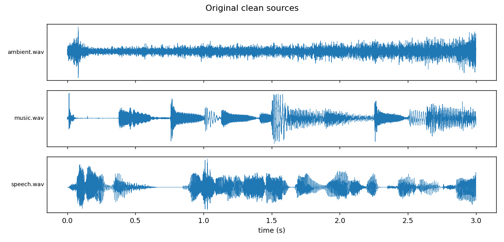
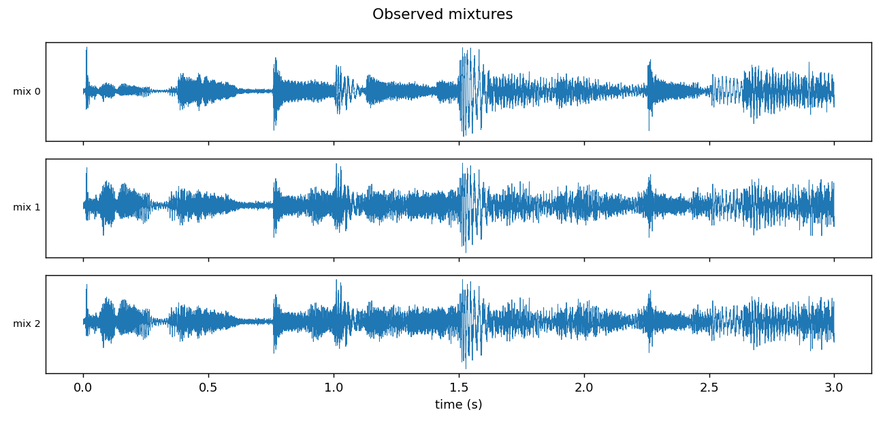
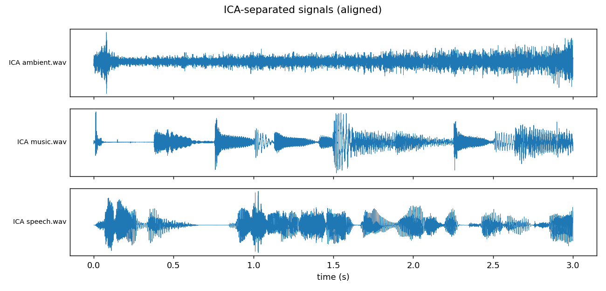
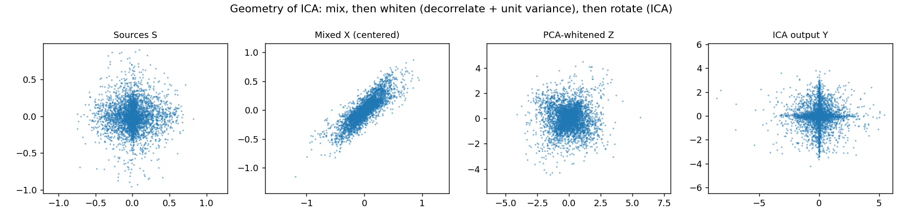
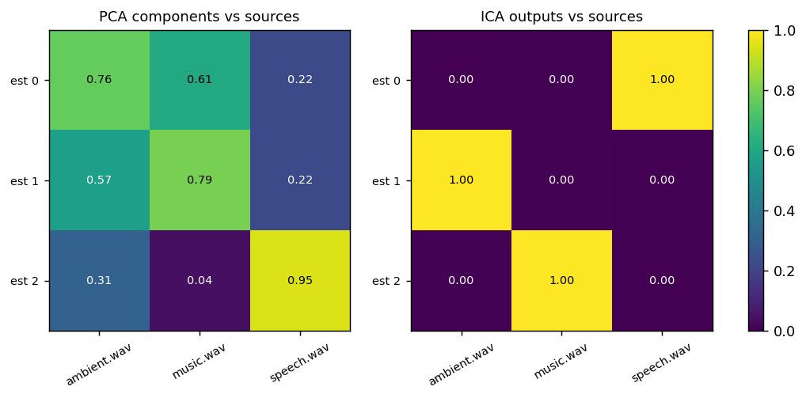
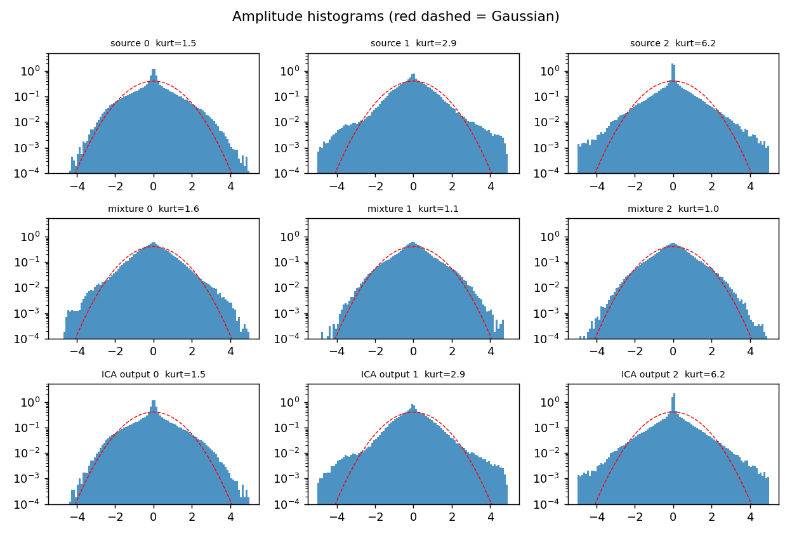
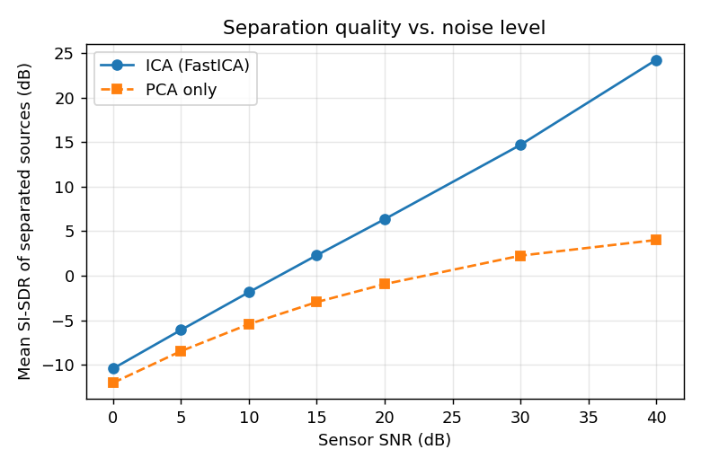

# Unmix the Signal: Blind Source Separation with FastICA (from scratch)

Recover clean audio sources from mixed recordings using **Independent Component Analysis**, implemented with only `numpy` / `scipy` / `matplotlib`. No library ICA, PCA or whitening functions are used.

> **Before submitting:** replace the synthetic demo sources with real speech / music / ambient WAVs (see [Using your own audio](#using-your-own-audio)), re-run, and update the numbers and audio links below.

## Pipeline

| Step | Where | What |
|---|---|---|
| 1 | `load_sources` / `synth_sources` | N clean sources (speech, music, ambient) |
| 2 | `make_mixing_matrix`, `mix` | `X = A S` with our own random, well-conditioned `A` (M >= N mixtures) |
| 3 | `center` | subtract per-channel mean |
| 4 | `pca_whiten` | covariance `C = E D Eᵀ` via `np.linalg.eigh`; `Z = D^(-1/2) Eᵀ X` so `cov(Z) = I` |
| 5 | `fastica` | fixed-point FastICA, symmetric or deflation; `logcosh`, `exp`, `cube` nonlinearities |
| 6 | `match_and_rescale` | resolve permutation (Hungarian) and sign/scale (least squares) |
| 7 | `evaluate`, `sdr_db` | \|correlation\| and (SI-)SDR vs. the originals |
| 8 | `save_wav` | export separated signals as 16-bit WAV |

## Setup & run

```bash
pip install -r requirements.txt

python ica_audio.py                              # synthetic demo sources
python ica_audio.py --sources data/sources       # your own clean WAVs
python ica_audio.py --sources data/sources --snr-sweep          # bonus: SNR experiment
python ica_audio.py --algo deflation --g exp                    # other FastICA variants
python ica_audio.py --sources data/sources --n-mix 4            # more mixtures than sources
```

Options: `--sr` (default 16000), `--seconds` (default 10), `--snr` (sensor noise in dB), `--seed` (mixing matrix).
Outputs go to `results/audio/` and `results/plots/`.

### Using your own audio

1. Put 3+ clean mono/stereo `.wav` files in `data/sources/` (e.g. `speech.wav`, `music.wav`, `ambient.wav`). They are resampled to 16 kHz, trimmed to equal length and peak-normalised.
2. Run `python ica_audio.py --sources data/sources`.
3. Make sure the sources are **non-Gaussian** (real speech/music/rain are; synthetic white Gaussian noise is *not separable*, see Q3).

## Audio files

| Signal | Original | Mixture | **ICA separated** | PCA only (baseline) |
|---|---|---|---|---|
| ambient | [source_0](results/audio/source_0_ambient.wav) | [mixture_0](results/audio/mixture_0.wav) | [separated_0](results/audio/separated_0_ambient.wav) | [pca_only_0](results/audio/pca_only_0_ambient.wav) |
| music | [source_1](results/audio/source_1_music.wav) | [mixture_1](results/audio/mixture_1.wav) | [separated_1](results/audio/separated_1_music.wav) | [pca_only_1](results/audio/pca_only_1_music.wav) |
| speech | [source_2](results/audio/source_2_speech.wav) | [mixture_2](results/audio/mixture_2.wav) | [separated_2](results/audio/separated_2_speech.wav) | [pca_only_2](results/audio/pca_only_2_speech.wav) |

## Results (real recordings: `ambient.wav`, `music.wav`, `speech.wav`)

| Source | \|corr\| mixture (best) | \|corr\| PCA | \|corr\| ICA | SI-SDR PCA (dB) | SI-SDR ICA (dB) |
|---|---|---|---|---|---|
| ambient | TODO | TODO | TODO | TODO | **45.61** |
| music | TODO | TODO | TODO | TODO | **44.13** |
| speech | TODO | TODO | TODO | TODO | **52.84** |
| **mean** | TODO | TODO | TODO | TODO | **47.53** |

Sanity checks printed by the script: `max|cov(Z) - I| ≈ 1e-8` (whitening works) and `max|W Wᵀ - I| ≈ 1e-10` (demixing matrix is orthogonal, as theory predicts for whitened data). FastICA converged in 4 iterations.

**FastICA variants (same data):** deflation+logcosh 44.99 dB, deflation+exp 46.07 dB, deflation+cube 38.47 dB. `cube` (kurtosis) is the least robust because it is sensitive to outliers.

### Plots

| | |
|---|---|
|  |  |
|  |  |
|  |  |

**Bonus: separation quality vs. sensor noise (SNR sweep)**



| Sensor SNR (dB) | 0 | 5 | 10 | 15 | 20 | 30 | 40 |
|---|---|---|---|---|---|---|---|
| ICA mean SI-SDR (dB) | -11.6 | -7.2 | -2.8 | 1.6 | 5.9 | 14.1 | 23.5 |
| PCA mean SI-SDR (dB) | -13.5 | -9.3 | -5.8 | -3.1 | -1.0 | 2.4 | 4.6 |

ICA beats PCA at every noise level, but quality degrades as noise grows: the model `X = AS` has no noise term, and the demixing matrix amplifies noise along poorly-conditioned directions.

## Theory

### 1. Why ICA over PCA? (uncorrelated vs. independent; second- vs. higher-order statistics)

PCA finds an orthogonal basis that **decorrelates** the data, using only the **covariance (second-order statistics)**. Uncorrelated means `E[yᵢyⱼ] = E[yᵢ]E[yⱼ]`. Independence is much stronger: the *joint density factorises*, `p(y₁,y₂) = p(y₁)p(y₂)`, which constrains **all** moments, not just the second.

Decorrelation leaves a rotational freedom. If `Z` has identity covariance, then `QZ` for *any* orthogonal `Q` also has identity covariance, so covariance alone cannot tell the correct rotation from a wrong one. PCA therefore returns directions of maximal *variance*, which are generally still mixtures of the sources (see the "PCA only" column above and the scatter plot: the whitened cloud is a rotated copy of the independent axes).

ICA picks the one rotation that makes the outputs **statistically independent**, which it measures through **higher-order statistics** (kurtosis, negentropy). Gaussians are fully described by mean and covariance, so uncorrelated Gaussians are already independent, but non-Gaussian sources carry the extra information that identifies the rotation.

### 2. What whitening does and why it simplifies ICA

Whitening linearly transforms centered data so that `cov(Z) = I`. We compute `C = E D Eᵀ` and set `Z = D^(-1/2) Eᵀ X`.

Why it helps: with `X = AS` and `cov(S) = I`, we have `cov(X) = AAᵀ`. After whitening, `Z = (D^(-1/2)EᵀA) S = A' S` with `A' A'ᵀ = I`, so **the new mixing matrix `A'` is orthogonal**. The unknown is reduced from a general `N×N` matrix (N² parameters) to a rotation (N(N-1)/2 parameters), which also makes the demixing matrix `W` orthogonal, so we can keep rows decorrelated with a cheap orthogonalisation step. Whitening also handles the second-order part for us, discards the scale ambiguity and, by dropping tiny eigenvalues, can reduce dimension and noise when there are more mixtures than sources. Everything left to do is a search over rotations using higher-order statistics.

### 3. Why non-Gaussianity enables separation, and how the CLT relates

The **Central Limit Theorem** says a sum of independent random variables tends toward a Gaussian. Each mixture is a weighted sum of independent sources, so **mixtures are more Gaussian than the sources** (visible in the histogram plot and the kurtosis printout: mixtures have excess kurtosis near 0-3 while sources reach 8 and 36).

ICA runs that logic in reverse: find directions `wᵀz` that are **maximally non-Gaussian**, since each such direction is the least "mixed". Non-Gaussianity is measured by kurtosis or, more robustly, by negentropy, approximated with `J(y) ∝ (E[G(y)] - E[G(ν)])²` for a contrast `G` (we use `log cosh`, `-exp(-u²/2)` or `u⁴`). FastICA maximises this with the fixed-point update `w ← E[z g(wᵀz)] - E[g'(wᵀz)] w`, then renormalises.

Consequences: (a) **at most one source may be Gaussian**, because a rotation of Gaussians is again Gaussian, so no direction is distinguished; (b) ICA can only recover sources **up to permutation, sign and scale** (the ordering and variance of the sources are not identifiable); (c) separation needs a linear, instantaneous mixture.

### 4. How experiments and metrics were chosen

* **Sources:** speech, music and ambient audio have different, strongly non-Gaussian (super-Gaussian/sparse) amplitude distributions, which is exactly what ICA needs. The demo uses synthetic stand-ins with the same properties.
* **Mixing:** a random matrix with entries in `[0.2, 1]` and a bounded condition number (`1.5 < cond < 30`) so the problem is well-posed, with M >= N mixtures (instantaneous mixing, no delay or reverberation).
* **Centering + PCA whitening** as above; whiteness verified numerically.
* **Algorithm choices:** symmetric FastICA (all components in parallel, no error accumulation) as the default, deflation as an alternative, and `log cosh` as the default contrast (robust to outliers; `cube` is fast but outlier-sensitive).
* **Handling ambiguity before measuring.** Because ICA output order, sign and scale are arbitrary, raw comparison would be meaningless. We (i) match each estimate to a source with the **Hungarian algorithm** on the |correlation| matrix (permutation + sign) and (ii) rescale by the least-squares gain.
* **Metrics:**
  * **|Pearson correlation|**: simple and interpretable, invariant to scale and sign (absolute value), but only says how *aligned* an estimate is, not how much interference remains (0.99 can still hide poor SDR).
  * **SI-SDR / SDR (dB)**: project the estimate onto the reference, `s_target = (⟨ŝ,s⟩/‖s‖²) s`, and report `10 log₁₀(‖s_target‖² / ‖ŝ - s_target‖²)`. It is scale invariant, directly measures residual interference/distortion in dB and is the standard in source separation, so it is more discriminating at high quality than correlation.
* **Baselines/experiments:** PCA-only (shows second-order statistics are insufficient), three nonlinearities, symmetric vs. deflation, and an SNR sweep (robustness to sensor noise).

## Limitations & future work

* Assumes **instantaneous, linear** mixing; real rooms add delays and reverb (convolutive mixtures need frequency-domain ICA).
* Requires M >= N and at most one Gaussian source.
* Demo results use synthetic sources, so real recordings from multiple devices will be harder (noise, clock drift, non-linear mics).
* Stretch ideas: mini-Shazam via spectrogram-peak fingerprinting on separated outputs; PCA-vs-ICA across more SNRs.

## Repo layout

```
ica_audio.py        # full from-scratch implementation + CLI
requirements.txt
data/sources/       # put your clean .wav files here
results/audio/      # sources, mixtures, separated and PCA-only WAVs
results/plots/      # figures used above
```
